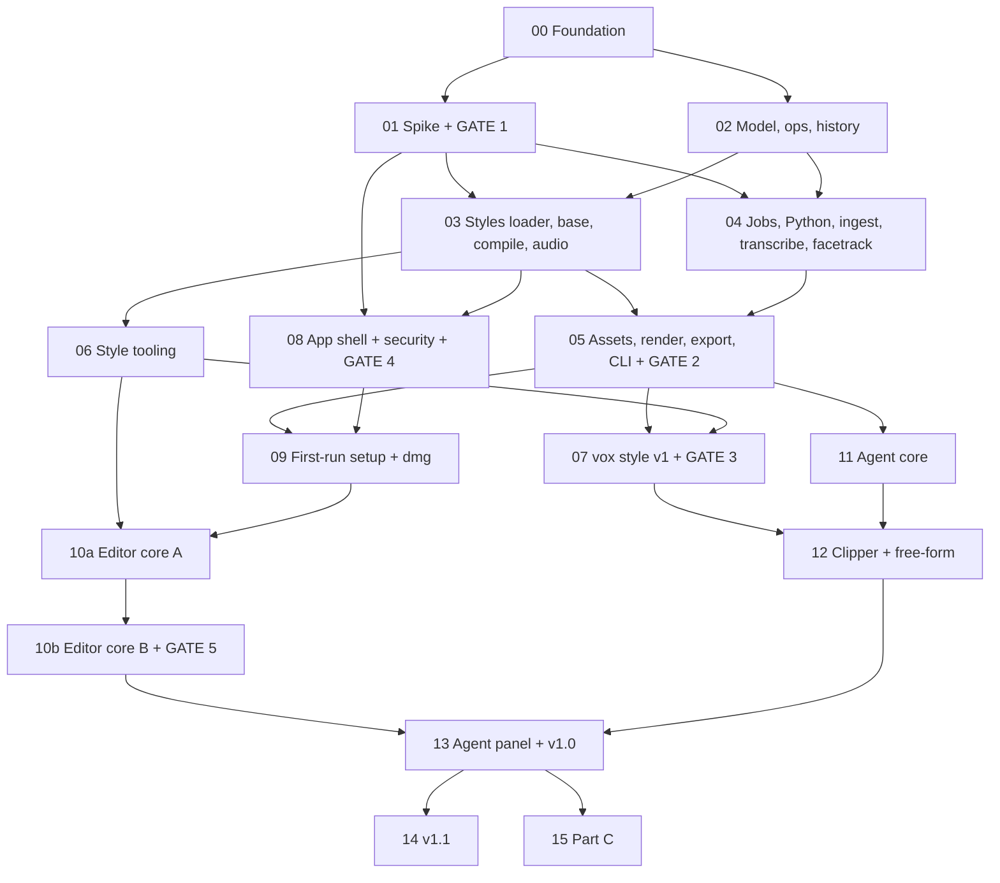

# Vox Studio — build plan

The specs in `docs/superpowers/specs/` say **what** to build. This folder says **in what order**
and **how to know each step is done**. If a phase file and a spec disagree, the spec wins. Fix the
phase file and log the decision in `log/DECISIONS.md`.

## 1. How to use

1. First time: paste the **intro prompt** below into Claude Code at the repo root. The AI reads the
   repo and explains the plan without changing anything.
2. To build: type the one-line prompt from [`PROMPT.md`](PROMPT.md). The AI picks the next phase that
   is not done in [`PROGRESS.md`](PROGRESS.md), works it to the end, logs it, and goes on to the next.
3. The AI stops only at a **GATE** (you decide), a **MANUAL STEP** (you do something on a real Mac, a
   real account or a second machine), or when its context is nearly full. To resume, type the same
   line again.
4. Everything you must do by hand is collected in [`TODO.md`](TODO.md).
5. To review the whole plan with any AI (read-only), use [`VERIFY_PROMPT.md`](VERIFY_PROMPT.md).

Intro prompt (read-only):

```text
Read plan/README.md, plan/PROGRESS.md, plan/TODO.md and docs/superpowers/specs/2026-10-10-vox-studio-overview.md.
Explain in at most 15 bullets: what Vox Studio is, which phase is next, what that phase will produce,
and which manual steps or gates are coming up. Do not change any file.
```

## 2. Folder structure

```
plan/
  README.md            this file: phase map, dependency graph, gates
  PROMPT.md            the execution prompt (auto mode + one phase)
  PROGRESS.md          one row per phase: status, dates, one-line result
  TODO.md              manual steps and decisions only the owner can make
  VERIFY_PROMPT.md     read-only review prompt for the whole plan
  phase-NN-<slug>.md   one file per phase: goal, reading, output, steps, verify, done-when, risks
  ref/
    R1-repo-layout.md        folders, package boundaries, import rules
    R2-contracts.md          where every contract lives and when it freezes
    R3-conventions.md        code, test, error, git and naming rules
    R4-security.md           every security invariant and the test that proves it
    R5-pins.md               pinned versions and licences (filled in as phases run)
    R6-models-skills.md      which model, effort, skills and review agents per phase
    R7-fixtures-evidence.md  fixtures, measurements and how evidence is stored
  log/
    DECISIONS.md       decision log (D-NN), newest last
    phase-NN.md        work log per phase, written by the AI while it works
```

## 3. Phase map

Status lives in `PROGRESS.md`, not here. "Spec §" points to the section a phase implements.
The plan has no time estimates (D-10); phases end when their done-when holds.

| No | Phase | Track | Main output | Spec § | Prereq | Model |
|---|---|---|---|---|---|---|
| 00 | Foundation | all | pnpm monorepo, CI, fixture generator, pins file | engine "Repository layout" | specs approved (D-10) | Sonnet 5.5 · medium |
| 01 | Spike + **GATE 1** | engine | `spike/`, `docs/SPIKE_RESULTS.md`, HyperFrames pin, go/hybrid + preview decision | engine "Spike", app "Untrusted HTML" | 00 | Opus 5.5 · high |
| 02 | Engine: model, ops, history | engine | `project.json` schema, frame grid (rational fps), all edit ops incl. `removePauses`/`removeWords`, change records, undo/redo/undoRun, `coalesceKey`, write results + `engine.view`, `JOB_CONFLICT` check, `SCHEMA_TOO_NEW`, crash-safe writes, lock, snapshots, path rule (D-15) | engine "Data model", "Edit operations", "History" | 00 | Opus 5.5 · high |
| 03 | Engine: styles loader, `base`, compile, captions, audio | engine | style registry + `base` style, sequence → HyperFrames build, `deriveCaptions` → `CaptionChunk[]`, framing keyframes as `transform`, ffmpeg mix graph (per-source gain, `denoise`, loudness targets), `minEntranceMs`, layer renderer (D-15) | engine "Compile", "Captions", "Audio", "Base style"; styles "Part A" (format, tokens, registry) | 01, 02 | Opus 5.5 · high |
| 04 | Engine: jobs, Python bridge, ingest, transcribe, facetrack | engine | job runner (results as one entry), `py/` tools, hardened ingest (filtering proxy, `-format_whitelist`; YouTube/Instagram/TikTok links and local files, D-13), VFR copy + loudness, VAD speech gate + transcription + word kinds, `shots`, face tracking with `auto` framing (D-15) | engine "Stages", "Ingest hardening", "Library API" (jobs) | 01, 02 | Opus 5.5 · high |
| 05 | Engine: assets, render, export, CLI + **GATE 2** | engine | archive search/fetch/cutout, render (`--loudness`, D-15), SRT/VTT/OTIO to a chosen file/folder (D-13), audio QA (D-14), credits, quick clips (cleaner boundaries, more signals, D-15) + `vox quick`, full `vox` CLI, engine done-when | engine "Archive assets", "Library API", "Done when" | 03, 04 | Sonnet 5.5 · high |
| 06 | Style tooling (Part A rest) | styles | `vox style validate/new/trust`, `extends` chains, trusted hooks, `TEMPLATE_VERSION` migration, previews | styles "Part A", "Testing" | 03 | Sonnet 5.5 · medium |
| 07 | `vox` style v1 + **GATE 3** | styles | tokens, fonts, 4 templates, 2 transitions, overlay, 2 caption presets, SFX kit of real recordings (D-14), `guide.md`, side-by-side sheet | styles "Part B" | 05, 06 | Opus 5.5 · high |
| 08 | App shell + security + **GATE 4** | app | Electron shell, `vox-app://` + `vox-media://`, engine host, typed `window.vox`, timeline benchmark | app "Architecture", "Window security", "Untrusted HTML", "Timeline implementation" | 01, 03 | Opus 5.5 · high |
| 09 | App: first-run setup + `.dmg` | app | setup screen, pinned + hash-checked tools, `pnpm dist` `.dmg`, update check, "Install `vox` command" | app "First-run setup", "Packaging and sharing" | 05, 08 | Sonnet 5.5 · high |
| 10a | App: editor core A | app | store + change records (`coalesceKey` on sliders), preview pipeline (VFR via CFR copy; pre-render cache only if GATE 1 recorded a heavy-scene fps margin under 20 %), top bar/menus/keyboard, preview controls, timeline incl. caption lane, inspector (framing `auto`, "Pin frame here", `denoise`, caption settings; D-15) | app "Live updates", "Preview pipeline", "Screens" (top bar, preview, timeline, inspector) | 06, 09 (D-16) | Sonnet 5.5 · high |
| 10b | App: editor core B + **GATE 5** | app | quick clips start screen (link badge, "Choose file…"), Subtitles panel ("Pauses & fillers", word delete, D-15), media bin + archive tab, export dialog (subtitles burned in or not, "Save to" folder, loudness target, audio check), style gallery, error states (`SCHEMA_TOO_NEW`, `JOB_CONFLICT`), E2E, CI latency bench; 4-core done-when + app done-when 7 | app "Screens" (quick clips, Subtitles panel, media bin, export, style gallery), "Error handling", "Testing", "Done when" 1, 7 | 10a | Sonnet 5.5 · high |
| 11 | Agent core | agent | providers + presets, Apple on-device helper, roles, probe (incl. tool-list cost), Keychain keys, redactor, cost cap, tools from zod (`allowedTools` + `describe_tool`/`call_tool`, short ids), loop (fresh view + change note, call repair, sub-runs, `update_todos`), compaction, plan mode, replay harness (D-15) | agent "Providers and models" … "Plan mode" | 05 | Opus 5.5 · high |
| 12 | Agent workflows: clipper + free-form | agent | clipper = quick clips + Stylize, workflow prompts + frontmatter + checkpoints, tighten step, sub-run per sequence, intent gate, `vox agent` CLI (`--yes`, `--confirm-plan`), mock-model tests, injection eval (image case), replay fixtures, live evals; agent done-when 1–4, 6–8 (D-15) | agent "Workflows", "CLI", "Testing", "Done when" | 07, 11 | Opus 5.5 · high |
| 13 | App: agent panel + settings + **v1.0** | app | agent panel, pause cards by `kind` (source, plan, pauses), "Confirm plan first", activity log with todo list, agent-editing tab marker (D-15), "Undo this run", provider settings, E2E, fresh-clone check + the owner's install from the GitHub Release (D-16); `v1.0.0` `.dmg` | app "Screens" (agent panel, settings), "Testing", "Done when" | 10b, 12 | Sonnet 5.5 · high |
| 14 | v1.1 | all | 4 more `vox` templates, screenplay workflow, Claude Code skill, mflux, FCPXML, clip speed, ducking | overview step 7 | 13 | Sonnet 5.5 · high |
| 15 | Styles Part C: style from reference | styles + agent + app | `vox style extract`, measure/describe/map/report, gallery flow, blind A/B | styles "Part C"; agent "Style extract" | 13 | Opus 5.5 · high |

Order for one person: `00 → 01 → 02 → 03 → 04 → 05 → 06 → 07 → 08 → 09 → 10a → 10b → 11 → 12 → 13 → 14 → 15`.

Can run in parallel (a second person, or a second worktree): 02 with 01 · 04 with 03 · 06 with 04/05 ·
08 right after 03 (uses the engine API with fixture projects) · 10a with 07 (10a needs only 06 and 09,
D-16) · 11 with 07–10b · 14a–14g each need
only 13 and run in any order.
Auto mode runs these in order but skips a phase that waits on a gate and goes on with the next phase
whose prerequisites are done (D-07). Each phase works in its own worktree `.worktrees/phase-<NN>`;
bookkeeping is committed on main. A finished phase first merges main into its branch, re-runs Verify,
then merges into main with `git merge --no-ff` (PROMPT step 11, D-10).

## 4. Dependency graph



## 5. Gates

A gate is a decision the owner makes from evidence. The AI prepares the evidence, writes a
recommendation in the phase log, and **stops**. Work after the gate starts only when the owner answers.
Exceptions: GATE 1 and GATE 4 are decided by their numbers (D-10). The AI records the result and the
outcome it selects, and continues; every fallback is already written in the specs. GATE 4 stops only if
the benchmark fails or lands within 10 % of the bar. The owner can still overrule later.
A gate inside a phase (GATE 4 in 08) is handled like a mid-phase MANUAL STEP (D-12, D-16): the AI
finishes the steps that do not depend on it, marks the phase `[~] waiting: GATE <n>`, and does not merge.
Judgement gates (GATE 3, GATE 6) get an exit after 3 rounds without approval: the owner chooses to keep
iterating or to accept the style as the v1 look, with the open notes logged as backlog (D-16).

| Gate | End of | Question | Evidence | If it fails |
|---|---|---|---|---|
| GATE 1 | 01 | Does HyperFrames render whole sequences, and does preview work in the Electron security setup? | `docs/SPIKE_RESULTS.md`: pass-bar items 1–7 and 9 (NTSC) with numbers, plus the heavy-scene fps margin and the filler count (item 8) (D-15) | Decided by the numbers (3 attempts per item). 1, 3 or 5 fail → hybrid export via layer renderer (phase 03). 4 fails in both sandbox modes, or 6 fails → app spec "Preview fallback" (pre-written). 4 fails only in opaque mode → `allow-same-origin` on `vox-media://`, no preview fallback. 4 passes with a heavy-scene fps margin under 20 % → pre-render cache (10a). 9 fails → integer fps only; NTSC sources conform to the nearest integer rate through the CFR copy (03, 04) |
| GATE 2 | 05 | Can the CLI alone turn a YouTube URL into a captioned 9:16 MP4, take Instagram/TikTok links and local files, export to a chosen folder, run the audio QA, and does the OTIO open in Resolve? | engine done-when 1–10 with evidence (10: NTSC and VFR quick clips, `removePauses`, `SCHEMA_TOO_NEW`; D-15) | Fix in 05; do not start 07 or 09 on a broken engine. A platform failure outside our control (still failing after `yt-dlp -U`) passes for that platform when the same video as a local file passes and the link fails with a clear `VoxError` hint; yt-dlp version and stderr logged, rechecked at GATE 5 (D-16). Resolve rejects the OTIO → FCPXML via `otio-fcpx-xml-adapter`; both rejected → README manual-import steps tested once by the owner (D-10) |
| GATE 3 | 07 | Does the `vox` style look like the reference reel, and do its sounds pass the owner's ear check? | side-by-side sheet (reel frames vs our fixture frames), SFX kit sheet, audio QA `qa.json` + `LISTEN.md` | Iterate templates/tokens/SFX in 07. After 3 rounds without approval the AI asks the owner: (a) keep iterating or (b) accept as the v1 look, open notes go to the phase log as backlog. The AI never accepts on its own (D-16) |
| GATE 4 | 08 (first UI task) | Does `@xzdarcy/react-timeline-editor` hold 1,000 items on 8 tracks at ≥ 50 fps, and fit linked drag + marquee (pass rule in app spec "Timeline implementation")? | benchmark numbers + prototype result | Build a custom canvas timeline in phase 10a (same store and ops) |
| GATE 5 | 10b | 4-core done: `.dmg` installs (09 automated clean-install test; the owner runs the E2E path on their own account with a fresh `VOX_HOME`, D-16), first-run setup passes, manual editing works end to end, quick clips with an edited subtitle export with no AI key, latency < 1 s; "Pauses & fillers", coalesced sliders, "Pin frame here" and loudness targets work (D-15) | app done-when 1 and 7 with evidence | Fix in 10a/10b before the agent panel |
| v1.0 | 13 | Can someone go from the README (GitHub clone or the shared `.dmg`) to a first exported clip? | automated fresh-clone check + the owner's install of the `v1.0.0` `.dmg` from the GitHub Release, checklist in `log/phase-13.md`; a friend's install is optional (D-16) | Fix README/setup, re-test |
| GATE 6 | 14a | Do the 4 new `vox` templates match the reference reel? | side-by-side sheet for the 4 templates | Iterate in 14a; same 3-round exit as GATE 3 (D-16) |
| GATE 7 | 14e | Is the clip-speed design right? | `playbackRate` spike numbers + design note | Revise the design in 14e before code |
| GATE 8 | 15 | Does the owner pick the extracted style as closer to the reference in the blind A/B? | blind A/B result | Iterate measure/describe/map in 15 and repeat the A/B |

## 6. Rules that apply to every phase

- One phase at a time. Each phase ends with working, tested software and a filled `log/phase-NN.md`.
- Tests first for code (see R3). Do not weaken or delete a test to make it pass.
- Contracts (R2) change only through a spec edit plus a `DECISIONS.md` entry.
- Security invariants (R4) are checked by tests, not by reading code.
- No real keys, personal paths or the owner's email in committed files. Test keys are canaries (R4).
- Pins (R5) are exact. A pin changes only with the phase's contract tests passing on the new version.
